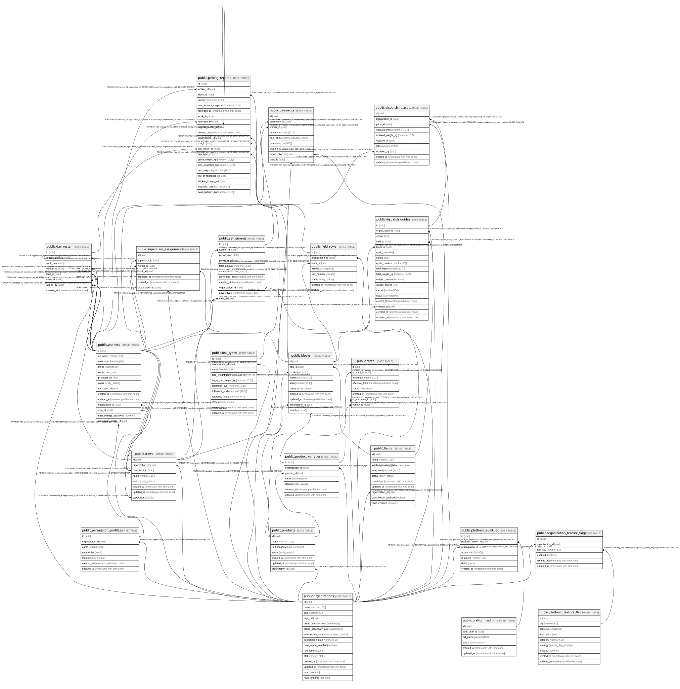

# postgres

## Tables

| Name                                                                      | Columns | Comment                                                                                                                                                                                                                | Type       |
| ------------------------------------------------------------------------- | ------- | ---------------------------------------------------------------------------------------------------------------------------------------------------------------------------------------------------------------------- | ---------- |
| [public.products](public.products.md)                                     | 7       | Catalogue of harvestable products (fruit types)                                                                                                                                                                        | BASE TABLE |
| [public.fields](public.fields.md)                                         | 10      | Farm/fundo - top-level productive unit                                                                                                                                                                                 | BASE TABLE |
| [public.blocks](public.blocks.md)                                         | 10      | Block/paño - subdivision of a field, linked to a product                                                                                                                                                               | BASE TABLE |
| [public.rates](public.rates.md)                                           | 8       | Price rates per unit (box/kg) for each product. Only one current rate per product at any time.                                                                                                                         | BASE TABLE |
| [public.workers](public.workers.md)                                       | 14      | Farm workers, supervisors, and admins. Linked to Supabase Auth.                                                                                                                                                        | BASE TABLE |
| [public.supervisor_assignments](public.supervisor_assignments.md)         | 7       | Maps supervisors to the workers and blocks they manage.                                                                                                                                                                | BASE TABLE |
| [public.picking_records](public.picking_records.md)                       | 21      | Individual harvest entries. Each record = one delivery of boxes/kg by a worker.                                                                                                                                        | BASE TABLE |
| [public.settlements](public.settlements.md)                               | 11      | Calculated payment due for a worker over a date range.                                                                                                                                                                 | BASE TABLE |
| [public.payments](public.payments.md)                                     | 9       | Actual payments made against settlements.                                                                                                                                                                              | BASE TABLE |
| [public.organizations](public.organizations.md)                           | 15      | Cliente/tenant del SaaS. Unidad de aislamiento de datos.                                                                                                                                                               | BASE TABLE |
| [public.platform_admins](public.platform_admins.md)                       | 6       | Administradores de plataforma (dueño/soporte del SaaS). Fuera del aislamiento de tenant.                                                                                                                               | BASE TABLE |
| [public.platform_audit_log](public.platform_audit_log.md)                 | 7       | Registro append-only de acciones de plataforma sobre datos de clientes.                                                                                                                                                | BASE TABLE |
| [public.crews](public.crews.md)                                           | 8       | Cuadrilla de trabajadores gestionada por un Encargado (crew_lead). Solo con Modo Capataz activo.                                                                                                                       | BASE TABLE |
| [public.field_rows](public.field_rows.md)                                 | 8       | Melga/hilera - subdivisión de un block (cuartel/paño). Nivel opcional (rows_enabled). Hereda producto y tarifa del block.                                                                                              | BASE TABLE |
| [public.day_roster](public.day_roster.md)                                 | 8       | Equipo de trabajo por jornada: qué trabajadores están a cargo de qué responsable (Encargado o Supervisor) en un work_day. Fuente de verdad operativa por día; workers.crew_id es solo la cuadrilla base de referencia. | BASE TABLE |
| [public.platform_feature_flags](public.platform_feature_flags.md)         | 9       | Catálogo global de feature flags de la plataforma (super-admin). Default global en enabled; override por tenant en organization_feature_flags.                                                                         | BASE TABLE |
| [public.organization_feature_flags](public.organization_feature_flags.md) | 6       | Override por organización de un feature flag global. Ausencia de fila = hereda el default global (platform_feature_flags.enabled).                                                                                     | BASE TABLE |
| [public.box_types](public.box_types.md)                                   | 11      | Tipos de caja/envase por organización, con destare (tara), peso neto objetivo y banda de tolerancia. Base del control de merma al pesar la cosecha.                                                                    | BASE TABLE |
| [public.permission_profiles](public.permission_profiles.md)               | 7       | Perfiles de permisos por organización. Restringen las capacidades de un usuario dentro de su rol (nunca amplían). Gestionados por el admin del cliente.                                                                | BASE TABLE |
| [public.product_varieties](public.product_varieties.md)                   | 7       | Variedades de producto por organización (nivel jerárquico bajo el producto). Un producto puede tener 0..N variedades; cada variedad puede asignarse a paños y tener tarifa propia.                                     | BASE TABLE |
| [public.dispatch_guides](public.dispatch_guides.md)                       | 18      | Guía de despacho (logística campo->cliente). Agrega picking_records (bandejas+peso) por paño o por campo/día. Independiente del pago. Gating: feature flag dispatch_guides.                                            | BASE TABLE |
| [public.dispatch_receipts](public.dispatch_receipts.md)                   | 10      | Recepción confirmada por el cliente/planta para una guía (bandejas+peso recibidos). Tabla separada 1:N-ready; hoy 1:1 por índice único uq_dispatch_receipt_one_per_guide.                                              | BASE TABLE |

## Stored procedures and functions

| Name                                  | ReturnType  | Arguments        | Type     |
| ------------------------------------- | ----------- | ---------------- | -------- |
| public.update_updated_at_column       | trigger     |                  | FUNCTION |
| public.prevent_paid_settlement_update | trigger     |                  | FUNCTION |
| public.get_worker_role                | worker_role | user_id uuid     | FUNCTION |
| public.get_worker_id                  | uuid        | user_id uuid     | FUNCTION |
| public.custom_access_token_hook       | jsonb       | event jsonb      | FUNCTION |
| public.is_admin                       | bool        |                  | FUNCTION |
| public.is_supervisor                  | bool        |                  | FUNCTION |
| public.is_worker                      | bool        |                  | FUNCTION |
| public.current_worker_id              | uuid        |                  | FUNCTION |
| public.current_org_id                 | uuid        |                  | FUNCTION |
| public.is_platform_admin              | bool        |                  | FUNCTION |
| public.is_crew_lead                   | bool        |                  | FUNCTION |
| public.current_crew_id                | uuid        |                  | FUNCTION |
| public.set_organization_id            | trigger     |                  | FUNCTION |
| public.validate_organization_timezone | trigger     |                  | FUNCTION |
| public.org_workday                    | date        | p_org_id uuid    | FUNCTION |
| public.current_org_workday            | date        |                  | FUNCTION |
| public.set_picking_work_day           | trigger     |                  | FUNCTION |
| public.set_day_roster_work_day        | trigger     |                  | FUNCTION |
| public.worker_in_my_roster_today      | bool        | p_worker_id uuid | FUNCTION |
| public.has_permission                 | bool        | capability text  | FUNCTION |
| public.validate_block_variety         | trigger     |                  | FUNCTION |
| public.prevent_closed_guide_update    | trigger     |                  | FUNCTION |

## Enums

| Name | Values |
| ---- | ------- |
| auth.aal_level | aal1, aal2, aal3 |
| auth.code_challenge_method | plain, s256 |
| auth.factor_status | unverified, verified |
| auth.factor_type | phone, totp, webauthn |
| auth.oauth_authorization_status | approved, denied, expired, pending |
| auth.oauth_client_type | confidential, public |
| auth.oauth_registration_type | dynamic, manual |
| auth.oauth_response_type | code |
| auth.one_time_token_type | confirmation_token, email_change_token_current, email_change_token_new, phone_change_token, reauthentication_token, recovery_token |
| net.request_status | ERROR, PENDING, SUCCESS |
| public.entity_status | active, inactive |
| public.feature_flag_strategy | global, kill_switch, org_override |
| public.rate_status | current, historical |
| public.settlement_payee_type | crew, worker |
| public.settlement_status | paid, partial, pending |
| public.subscription_status | active, cancelled, suspended, trial |
| public.tolerance_unit | kg, percent |
| public.unit_measure | box, kg |
| public.worker_role | admin, crew_lead, supervisor, worker |
| realtime.action | DELETE, ERROR, INSERT, TRUNCATE, UPDATE |
| realtime.equality_op | eq, gt, gte, ilike, imatch, in, is, isdistinct, like, lt, lte, match, neq |
| storage.buckettype | ANALYTICS, STANDARD, VECTOR |

## Relations

---

> Generated by [tbls](https://github.com/k1LoW/tbls)
