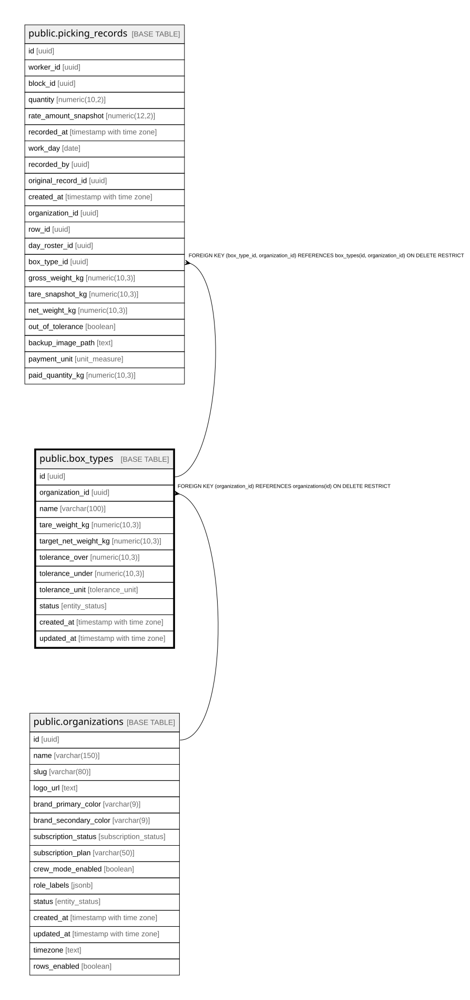

# public.box_types

## Description

Tipos de caja/envase por organización, con destare (tara), peso neto objetivo y banda de tolerancia. Base del control de merma al pesar la cosecha.

## Columns

| Name                 | Type                     | Default                   | Nullable | Children                                            | Parents                                         | Comment                                                                                         |
| -------------------- | ------------------------ | ------------------------- | -------- | --------------------------------------------------- | ----------------------------------------------- | ----------------------------------------------------------------------------------------------- |
| id                   | uuid                     | gen_random_uuid()         | false    | [public.picking_records](public.picking_records.md) |                                                 |                                                                                                 |
| organization_id      | uuid                     |                           | false    | [public.picking_records](public.picking_records.md) | [public.organizations](public.organizations.md) |                                                                                                 |
| name                 | varchar(100)             |                           | false    |                                                     |                                                 |                                                                                                 |
| tare_weight_kg       | numeric(10,3)            |                           | false    |                                                     |                                                 | Peso propio del envase (kg) que se resta del peso bruto para obtener el neto.                   |
| target_net_weight_kg | numeric(10,3)            |                           | false    |                                                     |                                                 | Peso neto objetivo de fruta por caja (kg).                                                      |
| tolerance_over       | numeric(10,3)            | 0                         | false    |                                                     |                                                 | Tolerancia superior permitida antes de alertar sobrellenado. En % o kg según tolerance_unit.    |
| tolerance_under      | numeric(10,3)            | 0                         | false    |                                                     |                                                 | Tolerancia inferior permitida antes de alertar caja incompleta. En % o kg según tolerance_unit. |
| tolerance_unit       | tolerance_unit           | 'percent'::tolerance_unit | false    |                                                     |                                                 | Unidad de las tolerancias: percent (% del objetivo) o kg (valor absoluto).                      |
| status               | entity_status            | 'active'::entity_status   | false    |                                                     |                                                 |                                                                                                 |
| created_at           | timestamp with time zone | now()                     | false    |                                                     |                                                 |                                                                                                 |
| updated_at           | timestamp with time zone | now()                     | false    |                                                     |                                                 |                                                                                                 |

## Constraints

| Name                                 | Type        | Definition                                                                    |
| ------------------------------------ | ----------- | ----------------------------------------------------------------------------- |
| box_types_tare_weight_kg_check       | CHECK       | CHECK ((tare_weight_kg >= (0)::numeric))                                      |
| box_types_target_net_weight_kg_check | CHECK       | CHECK ((target_net_weight_kg > (0)::numeric))                                 |
| box_types_tolerance_over_check       | CHECK       | CHECK ((tolerance_over >= (0)::numeric))                                      |
| box_types_tolerance_under_check      | CHECK       | CHECK ((tolerance_under >= (0)::numeric))                                     |
| box_types_organization_id_fkey       | FOREIGN KEY | FOREIGN KEY (organization_id) REFERENCES organizations(id) ON DELETE RESTRICT |
| box_types_pkey                       | PRIMARY KEY | PRIMARY KEY (id)                                                              |
| uq_box_types_id_org                  | UNIQUE      | UNIQUE (id, organization_id)                                                  |

## Indexes

| Name                       | Definition                                                                                    |
| -------------------------- | --------------------------------------------------------------------------------------------- |
| box_types_pkey             | CREATE UNIQUE INDEX box_types_pkey ON public.box_types USING btree (id)                       |
| uq_box_types_id_org        | CREATE UNIQUE INDEX uq_box_types_id_org ON public.box_types USING btree (id, organization_id) |
| idx_box_types_organization | CREATE INDEX idx_box_types_organization ON public.box_types USING btree (organization_id)     |
| idx_box_types_status       | CREATE INDEX idx_box_types_status ON public.box_types USING btree (status)                    |

## Triggers

| Name                     | Definition                                                                                                                         |
| ------------------------ | ---------------------------------------------------------------------------------------------------------------------------------- |
| trg_box_types_updated_at | CREATE TRIGGER trg_box_types_updated_at BEFORE UPDATE ON public.box_types FOR EACH ROW EXECUTE FUNCTION update_updated_at_column() |
| trg_set_org_id_box_types | CREATE TRIGGER trg_set_org_id_box_types BEFORE INSERT ON public.box_types FOR EACH ROW EXECUTE FUNCTION set_organization_id()      |

## Relations

---

> Generated by [tbls](https://github.com/k1LoW/tbls)
