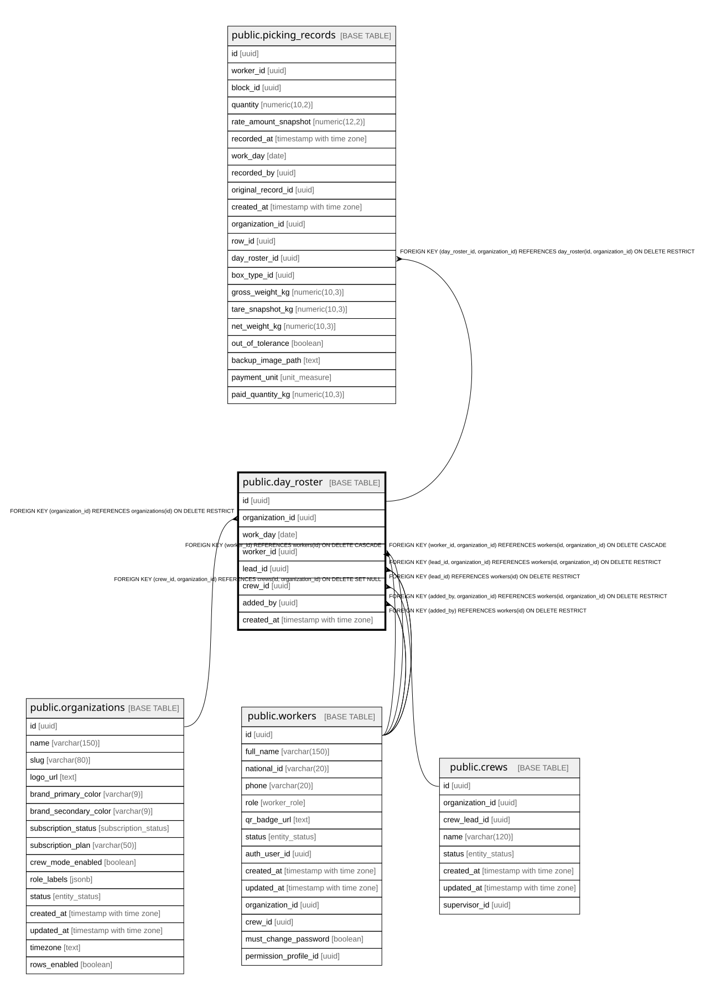

# public.day_roster

## Description

Equipo de trabajo por jornada: qué trabajadores están a cargo de qué responsable (Encargado o Supervisor) en un work_day. Fuente de verdad operativa por día; workers.crew_id es solo la cuadrilla base de referencia.

## Columns

| Name            | Type                     | Default           | Nullable | Children                                            | Parents                                                                                                             | Comment                                                                                                         |
| --------------- | ------------------------ | ----------------- | -------- | --------------------------------------------------- | ------------------------------------------------------------------------------------------------------------------- | --------------------------------------------------------------------------------------------------------------- |
| id              | uuid                     | gen_random_uuid() | false    | [public.picking_records](public.picking_records.md) |                                                                                                                     |                                                                                                                 |
| organization_id | uuid                     |                   | false    | [public.picking_records](public.picking_records.md) | [public.organizations](public.organizations.md) [public.workers](public.workers.md) [public.crews](public.crews.md) |                                                                                                                 |
| work_day        | date                     |                   | false    |                                                     |                                                                                                                     | Jornada (fecha) del equipo, en la zona horaria del tenant.                                                      |
| worker_id       | uuid                     |                   | false    |                                                     | [public.workers](public.workers.md)                                                                                 |                                                                                                                 |
| lead_id         | uuid                     |                   | false    |                                                     | [public.workers](public.workers.md)                                                                                 | Responsable del día: worker con rol crew_lead (Encargado) o supervisor cuando no hay Encargado.                 |
| crew_id         | uuid                     |                   | true     |                                                     | [public.crews](public.crews.md)                                                                                     | Cuadrilla asociada cuando el responsable es un Encargado. NULL si el trabajador depende directo del Supervisor. |
| added_by        | uuid                     |                   | false    |                                                     | [public.workers](public.workers.md)                                                                                 | Worker (responsable o supervisor) que agregó al trabajador al roster del día.                                   |
| created_at      | timestamp with time zone | now()             | false    |                                                     |                                                                                                                     |                                                                                                                 |

## Constraints

| Name                            | Type        | Definition                                                                                         | Comment                                                                                      |
| ------------------------------- | ----------- | -------------------------------------------------------------------------------------------------- | -------------------------------------------------------------------------------------------- |
| day_roster_added_by_fkey        | FOREIGN KEY | FOREIGN KEY (added_by) REFERENCES workers(id) ON DELETE RESTRICT                                   |                                                                                              |
| day_roster_lead_id_fkey         | FOREIGN KEY | FOREIGN KEY (lead_id) REFERENCES workers(id) ON DELETE RESTRICT                                    |                                                                                              |
| day_roster_worker_id_fkey       | FOREIGN KEY | FOREIGN KEY (worker_id) REFERENCES workers(id) ON DELETE CASCADE                                   |                                                                                              |
| day_roster_organization_id_fkey | FOREIGN KEY | FOREIGN KEY (organization_id) REFERENCES organizations(id) ON DELETE RESTRICT                      |                                                                                              |
| fk_day_roster_added_by_org      | FOREIGN KEY | FOREIGN KEY (added_by, organization_id) REFERENCES workers(id, organization_id) ON DELETE RESTRICT |                                                                                              |
| fk_day_roster_lead_org          | FOREIGN KEY | FOREIGN KEY (lead_id, organization_id) REFERENCES workers(id, organization_id) ON DELETE RESTRICT  |                                                                                              |
| fk_day_roster_worker_org        | FOREIGN KEY | FOREIGN KEY (worker_id, organization_id) REFERENCES workers(id, organization_id) ON DELETE CASCADE |                                                                                              |
| fk_day_roster_crew_org          | FOREIGN KEY | FOREIGN KEY (crew_id, organization_id) REFERENCES crews(id, organization_id) ON DELETE SET NULL    |                                                                                              |
| day_roster_pkey                 | PRIMARY KEY | PRIMARY KEY (id)                                                                                   |                                                                                              |
| uq_day_roster_worker_day        | UNIQUE      | UNIQUE (organization_id, work_day, worker_id)                                                      | Un trabajador tiene un único responsable por jornada (evita doble atribución de producción). |
| uq_day_roster_id_org            | UNIQUE      | UNIQUE (id, organization_id)                                                                       |                                                                                              |

## Indexes

| Name                        | Definition                                                                                                            |
| --------------------------- | --------------------------------------------------------------------------------------------------------------------- |
| day_roster_pkey             | CREATE UNIQUE INDEX day_roster_pkey ON public.day_roster USING btree (id)                                             |
| uq_day_roster_worker_day    | CREATE UNIQUE INDEX uq_day_roster_worker_day ON public.day_roster USING btree (organization_id, work_day, worker_id)  |
| idx_day_roster_organization | CREATE INDEX idx_day_roster_organization ON public.day_roster USING btree (organization_id)                           |
| idx_day_roster_lead_day     | CREATE INDEX idx_day_roster_lead_day ON public.day_roster USING btree (lead_id, work_day)                             |
| idx_day_roster_worker_day   | CREATE INDEX idx_day_roster_worker_day ON public.day_roster USING btree (worker_id, work_day)                         |
| idx_day_roster_crew_day     | CREATE INDEX idx_day_roster_crew_day ON public.day_roster USING btree (crew_id, work_day) WHERE (crew_id IS NOT NULL) |
| uq_day_roster_id_org        | CREATE UNIQUE INDEX uq_day_roster_id_org ON public.day_roster USING btree (id, organization_id)                       |

## Triggers

| Name                        | Definition                                                                                                                            |
| --------------------------- | ------------------------------------------------------------------------------------------------------------------------------------- |
| trg_set_org_id_day_roster   | CREATE TRIGGER trg_set_org_id_day_roster BEFORE INSERT ON public.day_roster FOR EACH ROW EXECUTE FUNCTION set_organization_id()       |
| trg_set_work_day_day_roster | CREATE TRIGGER trg_set_work_day_day_roster BEFORE INSERT ON public.day_roster FOR EACH ROW EXECUTE FUNCTION set_day_roster_work_day() |

## Relations

---

> Generated by [tbls](https://github.com/k1LoW/tbls)
