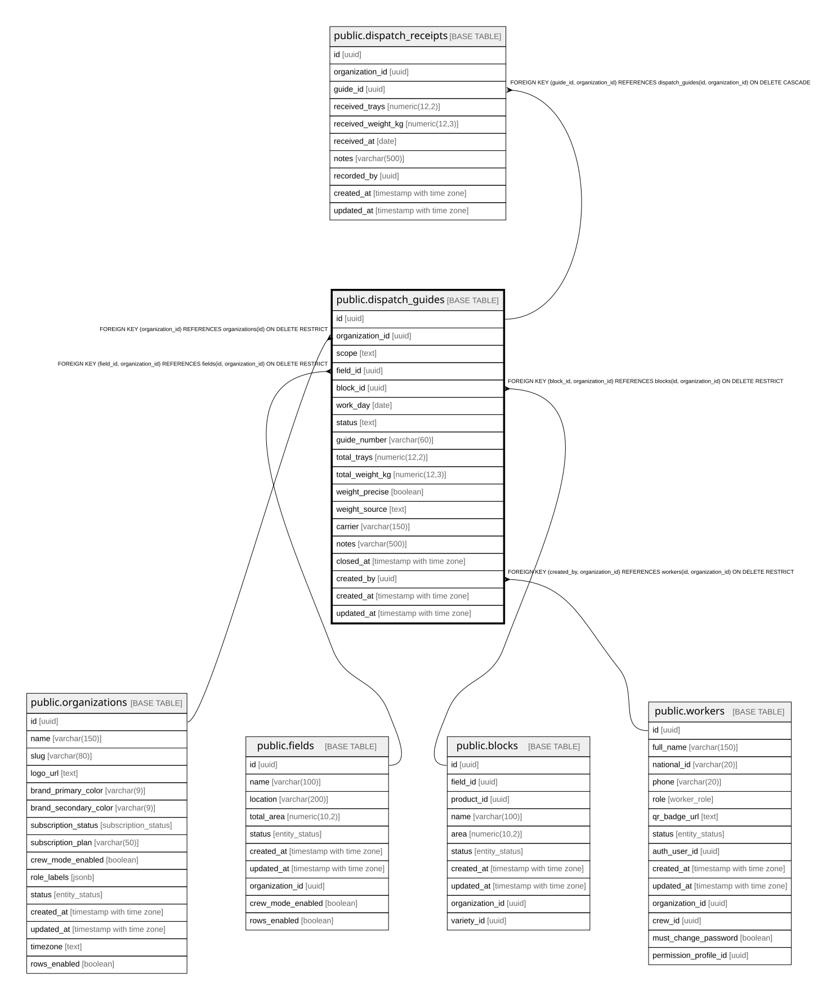

# public.dispatch_guides

## Description

Guía de despacho (logística campo->cliente). Agrega picking_records (bandejas+peso) por paño o por campo/día. Independiente del pago. Gating: feature flag dispatch_guides.

## Columns

| Name            | Type                     | Default           | Nullable | Children                                                | Parents                                                                                                                                                 | Comment                                                                                  |
| --------------- | ------------------------ | ----------------- | -------- | ------------------------------------------------------- | ------------------------------------------------------------------------------------------------------------------------------------------------------- | ---------------------------------------------------------------------------------------- |
| id              | uuid                     | gen_random_uuid() | false    | [public.dispatch_receipts](public.dispatch_receipts.md) |                                                                                                                                                         |                                                                                          |
| organization_id | uuid                     |                   | false    | [public.dispatch_receipts](public.dispatch_receipts.md) | [public.organizations](public.organizations.md) [public.fields](public.fields.md) [public.blocks](public.blocks.md) [public.workers](public.workers.md) |                                                                                          |
| scope           | text                     |                   | false    |                                                         |                                                                                                                                                         | block = por paño/cuartel; field = cierre diario del campo entero.                        |
| field_id        | uuid                     |                   | false    |                                                         | [public.fields](public.fields.md)                                                                                                                       | Campo de la guía. Siempre presente (en scope block se deriva del block.field_id).        |
| block_id        | uuid                     |                   | true     |                                                         | [public.blocks](public.blocks.md)                                                                                                                       | Paño de la guía. Solo scope=block; NULL en scope=field.                                  |
| work_day        | date                     |                   | false    |                                                         |                                                                                                                                                         |                                                                                          |
| status          | text                     | 'open'::text      | false    |                                                         |                                                                                                                                                         |                                                                                          |
| guide_number    | varchar(60)              |                   | false    |                                                         |                                                                                                                                                         |                                                                                          |
| total_trays     | numeric(12,2)            | 0                 | false    |                                                         |                                                                                                                                                         |                                                                                          |
| total_weight_kg | numeric(12,3)            | 0                 | false    |                                                         |                                                                                                                                                         |                                                                                          |
| weight_precise  | boolean                  | false             | false    |                                                         |                                                                                                                                                         | true = peso de balanza (SUM net_weight_kg); false = aproximado o editado a mano.         |
| weight_source   | text                     | 'estimated'::text | false    |                                                         |                                                                                                                                                         | scale (todo balanza), estimated (todo aproximado), mixed (parte balanza/parte estimado). |
| carrier         | varchar(150)             |                   | true     |                                                         |                                                                                                                                                         |                                                                                          |
| notes           | varchar(500)             |                   | true     |                                                         |                                                                                                                                                         |                                                                                          |
| closed_at       | timestamp with time zone |                   | true     |                                                         |                                                                                                                                                         |                                                                                          |
| created_by      | uuid                     |                   | false    |                                                         | [public.workers](public.workers.md)                                                                                                                     |                                                                                          |
| created_at      | timestamp with time zone | now()             | false    |                                                         |                                                                                                                                                         |                                                                                          |
| updated_at      | timestamp with time zone | now()             | false    |                                                         |                                                                                                                                                         |                                                                                          |

## Constraints

| Name                                  | Type        | Definition                                                                                                         |
| ------------------------------------- | ----------- | ------------------------------------------------------------------------------------------------------------------ |
| chk_dispatch_scope_block              | CHECK       | CHECK ((((scope = 'field'::text) AND (block_id IS NULL)) OR ((scope = 'block'::text) AND (block_id IS NOT NULL)))) |
| dispatch_guides_scope_check           | CHECK       | CHECK ((scope = ANY (ARRAY['block'::text, 'field'::text])))                                                        |
| dispatch_guides_status_check          | CHECK       | CHECK ((status = ANY (ARRAY['open'::text, 'closed'::text])))                                                       |
| dispatch_guides_total_trays_check     | CHECK       | CHECK ((total_trays >= (0)::numeric))                                                                              |
| dispatch_guides_total_weight_kg_check | CHECK       | CHECK ((total_weight_kg >= (0)::numeric))                                                                          |
| dispatch_guides_weight_source_check   | CHECK       | CHECK ((weight_source = ANY (ARRAY['scale'::text, 'estimated'::text, 'mixed'::text])))                             |
| dispatch_guides_organization_id_fkey  | FOREIGN KEY | FOREIGN KEY (organization_id) REFERENCES organizations(id) ON DELETE RESTRICT                                      |
| fk_dispatch_field_org                 | FOREIGN KEY | FOREIGN KEY (field_id, organization_id) REFERENCES fields(id, organization_id) ON DELETE RESTRICT                  |
| fk_dispatch_block_org                 | FOREIGN KEY | FOREIGN KEY (block_id, organization_id) REFERENCES blocks(id, organization_id) ON DELETE RESTRICT                  |
| fk_dispatch_created_by_org            | FOREIGN KEY | FOREIGN KEY (created_by, organization_id) REFERENCES workers(id, organization_id) ON DELETE RESTRICT               |
| dispatch_guides_pkey                  | PRIMARY KEY | PRIMARY KEY (id)                                                                                                   |
| uq_dispatch_guides_id_org             | UNIQUE      | UNIQUE (id, organization_id)                                                                                       |
| uq_dispatch_guide_number              | UNIQUE      | UNIQUE (organization_id, guide_number)                                                                             |

## Indexes

| Name                             | Definition                                                                                                                                          |
| -------------------------------- | --------------------------------------------------------------------------------------------------------------------------------------------------- |
| dispatch_guides_pkey             | CREATE UNIQUE INDEX dispatch_guides_pkey ON public.dispatch_guides USING btree (id)                                                                 |
| uq_dispatch_guides_id_org        | CREATE UNIQUE INDEX uq_dispatch_guides_id_org ON public.dispatch_guides USING btree (id, organization_id)                                           |
| uq_dispatch_guide_number         | CREATE UNIQUE INDEX uq_dispatch_guide_number ON public.dispatch_guides USING btree (organization_id, guide_number)                                  |
| uq_dispatch_field_day            | CREATE UNIQUE INDEX uq_dispatch_field_day ON public.dispatch_guides USING btree (organization_id, field_id, work_day) WHERE (scope = 'field'::text) |
| idx_dispatch_guides_organization | CREATE INDEX idx_dispatch_guides_organization ON public.dispatch_guides USING btree (organization_id)                                               |
| idx_dispatch_guides_field_id     | CREATE INDEX idx_dispatch_guides_field_id ON public.dispatch_guides USING btree (field_id)                                                          |
| idx_dispatch_guides_block_id     | CREATE INDEX idx_dispatch_guides_block_id ON public.dispatch_guides USING btree (block_id) WHERE (block_id IS NOT NULL)                             |
| idx_dispatch_guides_org_workday  | CREATE INDEX idx_dispatch_guides_org_workday ON public.dispatch_guides USING btree (organization_id, work_day)                                      |
| idx_dispatch_guides_status       | CREATE INDEX idx_dispatch_guides_status ON public.dispatch_guides USING btree (status)                                                              |

## Triggers

| Name                                      | Definition                                                                                                                                                   |
| ----------------------------------------- | ------------------------------------------------------------------------------------------------------------------------------------------------------------ |
| trg_dispatch_guides_updated_at            | CREATE TRIGGER trg_dispatch_guides_updated_at BEFORE UPDATE ON public.dispatch_guides FOR EACH ROW EXECUTE FUNCTION update_updated_at_column()               |
| trg_set_org_id_dispatch_guides            | CREATE TRIGGER trg_set_org_id_dispatch_guides BEFORE INSERT ON public.dispatch_guides FOR EACH ROW EXECUTE FUNCTION set_organization_id()                    |
| trg_dispatch_guides_immutable_when_closed | CREATE TRIGGER trg_dispatch_guides_immutable_when_closed BEFORE UPDATE ON public.dispatch_guides FOR EACH ROW EXECUTE FUNCTION prevent_closed_guide_update() |

## Relations

---

> Generated by [tbls](https://github.com/k1LoW/tbls)
