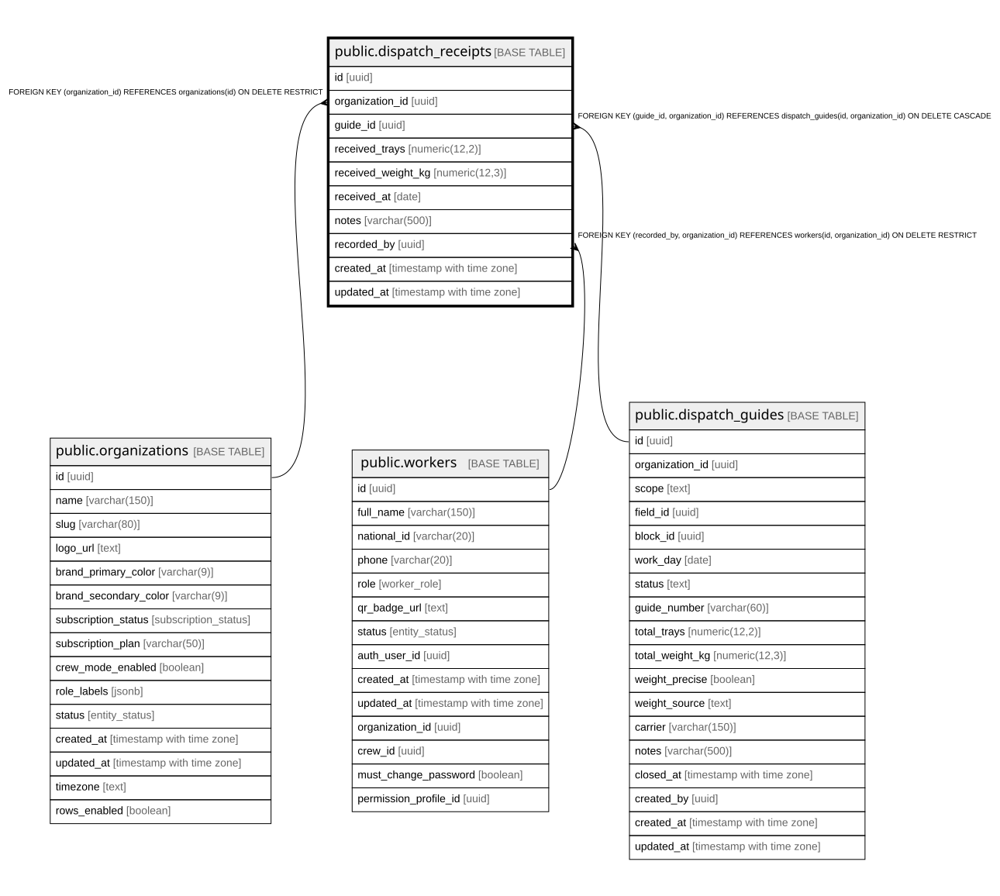

# public.dispatch_receipts

## Description

Recepción confirmada por el cliente/planta para una guía (bandejas+peso recibidos). Tabla separada 1:N-ready; hoy 1:1 por índice único uq_dispatch_receipt_one_per_guide.

## Columns

| Name               | Type                     | Default           | Nullable | Children | Parents                                                                                                                                 | Comment |
| ------------------ | ------------------------ | ----------------- | -------- | -------- | --------------------------------------------------------------------------------------------------------------------------------------- | ------- |
| id                 | uuid                     | gen_random_uuid() | false    |          |                                                                                                                                         |         |
| organization_id    | uuid                     |                   | false    |          | [public.organizations](public.organizations.md) [public.workers](public.workers.md) [public.dispatch_guides](public.dispatch_guides.md) |         |
| guide_id           | uuid                     |                   | false    |          | [public.dispatch_guides](public.dispatch_guides.md)                                                                                     |         |
| received_trays     | numeric(12,2)            |                   | false    |          |                                                                                                                                         |         |
| received_weight_kg | numeric(12,3)            |                   | false    |          |                                                                                                                                         |         |
| received_at        | date                     | CURRENT_DATE      | false    |          |                                                                                                                                         |         |
| notes              | varchar(500)             |                   | true     |          |                                                                                                                                         |         |
| recorded_by        | uuid                     |                   | false    |          | [public.workers](public.workers.md)                                                                                                     |         |
| created_at         | timestamp with time zone | now()             | false    |          |                                                                                                                                         |         |
| updated_at         | timestamp with time zone | now()             | false    |          |                                                                                                                                         |         |

## Constraints

| Name                                       | Type        | Definition                                                                                                |
| ------------------------------------------ | ----------- | --------------------------------------------------------------------------------------------------------- |
| dispatch_receipts_received_trays_check     | CHECK       | CHECK ((received_trays >= (0)::numeric))                                                                  |
| dispatch_receipts_received_weight_kg_check | CHECK       | CHECK ((received_weight_kg >= (0)::numeric))                                                              |
| dispatch_receipts_organization_id_fkey     | FOREIGN KEY | FOREIGN KEY (organization_id) REFERENCES organizations(id) ON DELETE RESTRICT                             |
| fk_receipt_recorded_by_org                 | FOREIGN KEY | FOREIGN KEY (recorded_by, organization_id) REFERENCES workers(id, organization_id) ON DELETE RESTRICT     |
| fk_receipt_guide_org                       | FOREIGN KEY | FOREIGN KEY (guide_id, organization_id) REFERENCES dispatch_guides(id, organization_id) ON DELETE CASCADE |
| dispatch_receipts_pkey                     | PRIMARY KEY | PRIMARY KEY (id)                                                                                          |
| uq_dispatch_receipts_id_org                | UNIQUE      | UNIQUE (id, organization_id)                                                                              |

## Indexes

| Name                               | Definition                                                                                                    | Comment                                                                                            |
| ---------------------------------- | ------------------------------------------------------------------------------------------------------------- | -------------------------------------------------------------------------------------------------- |
| dispatch_receipts_pkey             | CREATE UNIQUE INDEX dispatch_receipts_pkey ON public.dispatch_receipts USING btree (id)                       |                                                                                                    |
| uq_dispatch_receipts_id_org        | CREATE UNIQUE INDEX uq_dispatch_receipts_id_org ON public.dispatch_receipts USING btree (id, organization_id) |                                                                                                    |
| uq_dispatch_receipt_one_per_guide  | CREATE UNIQUE INDEX uq_dispatch_receipt_one_per_guide ON public.dispatch_receipts USING btree (guide_id)      | Restringe a una recepción por guía (1:1). Eliminar este índice habilita recepciones parciales 1:N. |
| idx_dispatch_receipts_organization | CREATE INDEX idx_dispatch_receipts_organization ON public.dispatch_receipts USING btree (organization_id)     |                                                                                                    |
| idx_dispatch_receipts_guide_id     | CREATE INDEX idx_dispatch_receipts_guide_id ON public.dispatch_receipts USING btree (guide_id)                |                                                                                                    |

## Triggers

| Name                             | Definition                                                                                                                                         |
| -------------------------------- | -------------------------------------------------------------------------------------------------------------------------------------------------- |
| trg_dispatch_receipts_updated_at | CREATE TRIGGER trg_dispatch_receipts_updated_at BEFORE UPDATE ON public.dispatch_receipts FOR EACH ROW EXECUTE FUNCTION update_updated_at_column() |
| trg_set_org_id_dispatch_receipts | CREATE TRIGGER trg_set_org_id_dispatch_receipts BEFORE INSERT ON public.dispatch_receipts FOR EACH ROW EXECUTE FUNCTION set_organization_id()      |

## Relations

---

> Generated by [tbls](https://github.com/k1LoW/tbls)
