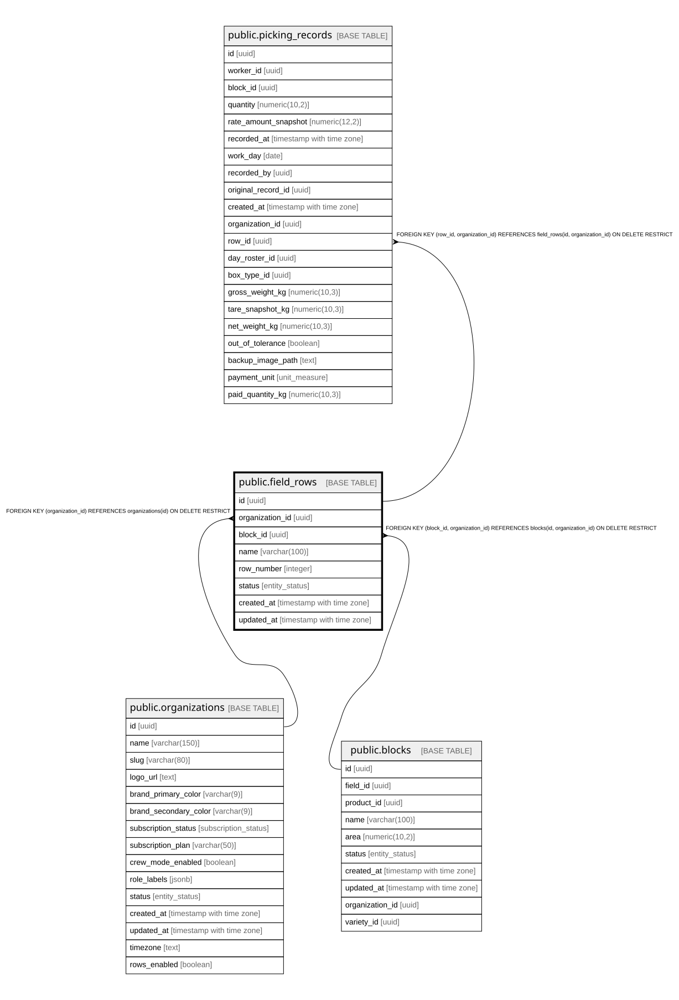

# public.field_rows

## Description

Melga/hilera - subdivisión de un block (cuartel/paño). Nivel opcional (rows_enabled). Hereda producto y tarifa del block.

## Columns

| Name            | Type                     | Default                 | Nullable | Children                                            | Parents                                                                           | Comment                                                            |
| --------------- | ------------------------ | ----------------------- | -------- | --------------------------------------------------- | --------------------------------------------------------------------------------- | ------------------------------------------------------------------ |
| id              | uuid                     | gen_random_uuid()       | false    | [public.picking_records](public.picking_records.md) |                                                                                   |                                                                    |
| organization_id | uuid                     |                         | false    | [public.picking_records](public.picking_records.md) | [public.organizations](public.organizations.md) [public.blocks](public.blocks.md) |                                                                    |
| block_id        | uuid                     |                         | false    |                                                     | [public.blocks](public.blocks.md)                                                 | Block (cuartel/paño) al que pertenece la melga.                    |
| name            | varchar(100)             |                         | false    |                                                     |                                                                                   |                                                                    |
| row_number      | integer                  |                         | true     |                                                     |                                                                                   | Número de melga/hilera para ordenar y ubicar en terreno. Opcional. |
| status          | entity_status            | 'active'::entity_status | false    |                                                     |                                                                                   |                                                                    |
| created_at      | timestamp with time zone | now()                   | false    |                                                     |                                                                                   |                                                                    |
| updated_at      | timestamp with time zone | now()                   | false    |                                                     |                                                                                   |                                                                    |

## Constraints

| Name                            | Type        | Definition                                                                                        | Comment                                                               |
| ------------------------------- | ----------- | ------------------------------------------------------------------------------------------------- | --------------------------------------------------------------------- |
| field_rows_row_number_check     | CHECK       | CHECK (((row_number IS NULL) OR (row_number > 0)))                                                |                                                                       |
| field_rows_organization_id_fkey | FOREIGN KEY | FOREIGN KEY (organization_id) REFERENCES organizations(id) ON DELETE RESTRICT                     |                                                                       |
| fk_field_rows_block_org         | FOREIGN KEY | FOREIGN KEY (block_id, organization_id) REFERENCES blocks(id, organization_id) ON DELETE RESTRICT | Garantiza que la melga y su block pertenecen a la misma organización. |
| field_rows_pkey                 | PRIMARY KEY | PRIMARY KEY (id)                                                                                  |                                                                       |
| uq_field_rows_id_org            | UNIQUE      | UNIQUE (id, organization_id)                                                                      |                                                                       |

## Indexes

| Name                        | Definition                                                                                      |
| --------------------------- | ----------------------------------------------------------------------------------------------- |
| field_rows_pkey             | CREATE UNIQUE INDEX field_rows_pkey ON public.field_rows USING btree (id)                       |
| idx_field_rows_block_id     | CREATE INDEX idx_field_rows_block_id ON public.field_rows USING btree (block_id)                |
| idx_field_rows_organization | CREATE INDEX idx_field_rows_organization ON public.field_rows USING btree (organization_id)     |
| idx_field_rows_status       | CREATE INDEX idx_field_rows_status ON public.field_rows USING btree (status)                    |
| uq_field_rows_id_org        | CREATE UNIQUE INDEX uq_field_rows_id_org ON public.field_rows USING btree (id, organization_id) |

## Triggers

| Name                      | Definition                                                                                                                           |
| ------------------------- | ------------------------------------------------------------------------------------------------------------------------------------ |
| trg_field_rows_updated_at | CREATE TRIGGER trg_field_rows_updated_at BEFORE UPDATE ON public.field_rows FOR EACH ROW EXECUTE FUNCTION update_updated_at_column() |
| trg_set_org_id_field_rows | CREATE TRIGGER trg_set_org_id_field_rows BEFORE INSERT ON public.field_rows FOR EACH ROW EXECUTE FUNCTION set_organization_id()      |

## Relations

---

> Generated by [tbls](https://github.com/k1LoW/tbls)
