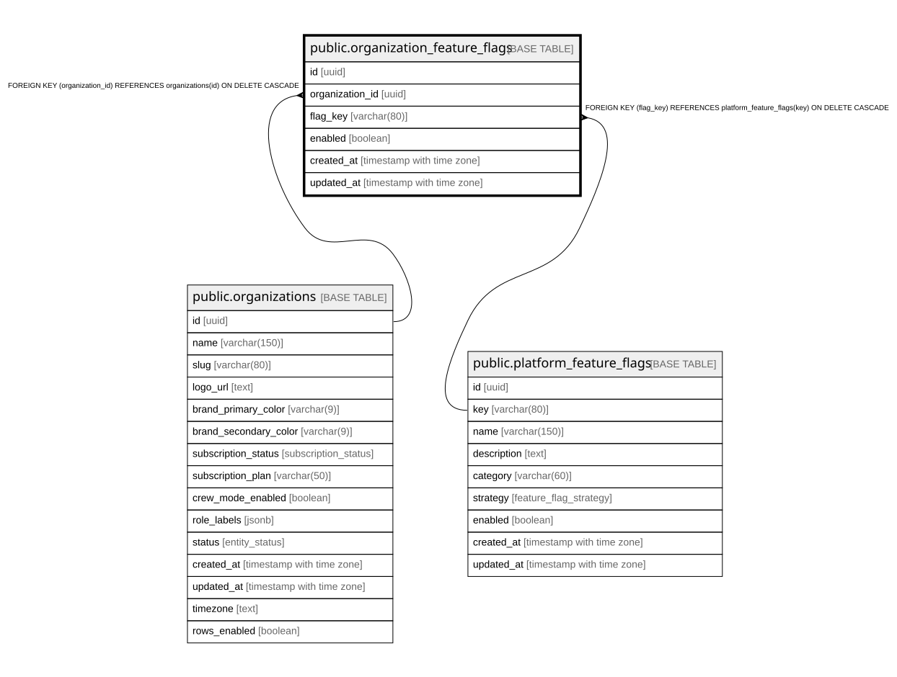

# public.organization_feature_flags

## Description

Override por organización de un feature flag global. Ausencia de fila = hereda el default global (platform_feature_flags.enabled).

## Columns

| Name            | Type                     | Default           | Nullable | Children | Parents                                                           | Comment                                                                          |
| --------------- | ------------------------ | ----------------- | -------- | -------- | ----------------------------------------------------------------- | -------------------------------------------------------------------------------- |
| id              | uuid                     | gen_random_uuid() | false    |          |                                                                   |                                                                                  |
| organization_id | uuid                     |                   | false    |          | [public.organizations](public.organizations.md)                   |                                                                                  |
| flag_key        | varchar(80)              |                   | false    |          | [public.platform_feature_flags](public.platform_feature_flags.md) | Referencia al key del flag global.                                               |
| enabled         | boolean                  |                   | false    |          |                                                                   | Valor efectivo del flag para esta organización (sobreescribe el default global). |
| created_at      | timestamp with time zone | now()             | false    |          |                                                                   |                                                                                  |
| updated_at      | timestamp with time zone | now()             | false    |          |                                                                   |                                                                                  |

## Constraints

| Name                                            | Type        | Definition                                                                      |
| ----------------------------------------------- | ----------- | ------------------------------------------------------------------------------- |
| organization_feature_flags_organization_id_fkey | FOREIGN KEY | FOREIGN KEY (organization_id) REFERENCES organizations(id) ON DELETE CASCADE    |
| organization_feature_flags_flag_key_fkey        | FOREIGN KEY | FOREIGN KEY (flag_key) REFERENCES platform_feature_flags(key) ON DELETE CASCADE |
| organization_feature_flags_pkey                 | PRIMARY KEY | PRIMARY KEY (id)                                                                |
| uq_org_feature_flags                            | UNIQUE      | UNIQUE (organization_id, flag_key)                                              |

## Indexes

| Name                            | Definition                                                                                                            |
| ------------------------------- | --------------------------------------------------------------------------------------------------------------------- |
| organization_feature_flags_pkey | CREATE UNIQUE INDEX organization_feature_flags_pkey ON public.organization_feature_flags USING btree (id)             |
| uq_org_feature_flags            | CREATE UNIQUE INDEX uq_org_feature_flags ON public.organization_feature_flags USING btree (organization_id, flag_key) |
| idx_org_feature_flags_org       | CREATE INDEX idx_org_feature_flags_org ON public.organization_feature_flags USING btree (organization_id)             |
| idx_org_feature_flags_key       | CREATE INDEX idx_org_feature_flags_key ON public.organization_feature_flags USING btree (flag_key)                    |

## Triggers

| Name                             | Definition                                                                                                                                                  |
| -------------------------------- | ----------------------------------------------------------------------------------------------------------------------------------------------------------- |
| trg_org_feature_flags_updated_at | CREATE TRIGGER trg_org_feature_flags_updated_at BEFORE UPDATE ON public.organization_feature_flags FOR EACH ROW EXECUTE FUNCTION update_updated_at_column() |
| trg_set_org_id_org_feature_flags | CREATE TRIGGER trg_set_org_id_org_feature_flags BEFORE INSERT ON public.organization_feature_flags FOR EACH ROW EXECUTE FUNCTION set_organization_id()      |

## Relations

---

> Generated by [tbls](https://github.com/k1LoW/tbls)
