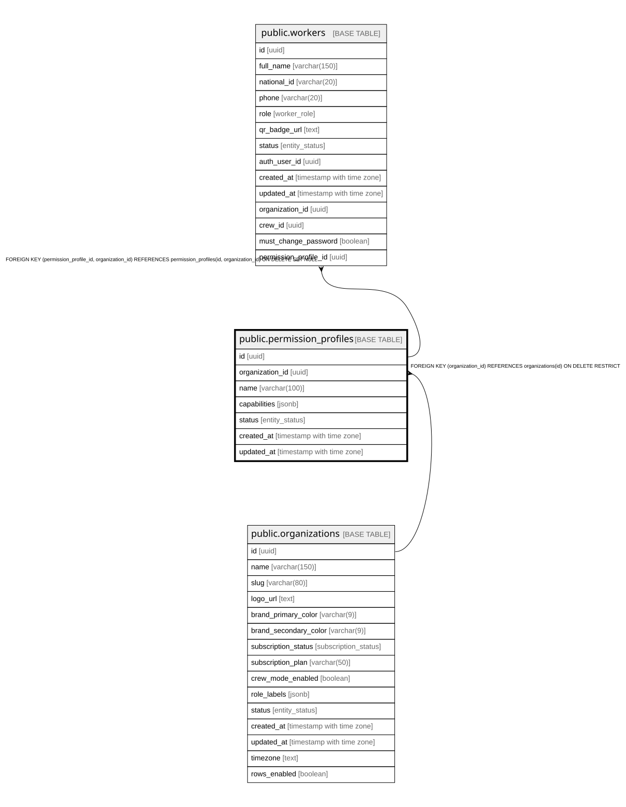

# public.permission_profiles

## Description

Perfiles de permisos por organización. Restringen las capacidades de un usuario dentro de su rol (nunca amplían). Gestionados por el admin del cliente.

## Columns

| Name            | Type                     | Default                 | Nullable | Children                            | Parents                                         | Comment                                                                                      |
| --------------- | ------------------------ | ----------------------- | -------- | ----------------------------------- | ----------------------------------------------- | -------------------------------------------------------------------------------------------- |
| id              | uuid                     | gen_random_uuid()       | false    | [public.workers](public.workers.md) |                                                 |                                                                                              |
| organization_id | uuid                     |                         | false    | [public.workers](public.workers.md) | [public.organizations](public.organizations.md) |                                                                                              |
| name            | varchar(100)             |                         | false    |                                     |                                                 |                                                                                              |
| capabilities    | jsonb                    | '[]'::jsonb             | false    |                                     |                                                 | Array JSONB de capacidades habilitadas (keys del catálogo CAPABILITIES en @fundo360/shared). |
| status          | entity_status            | 'active'::entity_status | false    |                                     |                                                 |                                                                                              |
| created_at      | timestamp with time zone | now()                   | false    |                                     |                                                 |                                                                                              |
| updated_at      | timestamp with time zone | now()                   | false    |                                     |                                                 |                                                                                              |

## Constraints

| Name                                          | Type        | Definition                                                                    |
| --------------------------------------------- | ----------- | ----------------------------------------------------------------------------- |
| chk_permission_profiles_capabilities_is_array | CHECK       | CHECK ((jsonb_typeof(capabilities) = 'array'::text))                          |
| permission_profiles_organization_id_fkey      | FOREIGN KEY | FOREIGN KEY (organization_id) REFERENCES organizations(id) ON DELETE RESTRICT |
| permission_profiles_pkey                      | PRIMARY KEY | PRIMARY KEY (id)                                                              |
| uq_permission_profiles_id_org                 | UNIQUE      | UNIQUE (id, organization_id)                                                  |

## Indexes

| Name                                 | Definition                                                                                                        |
| ------------------------------------ | ----------------------------------------------------------------------------------------------------------------- |
| permission_profiles_pkey             | CREATE UNIQUE INDEX permission_profiles_pkey ON public.permission_profiles USING btree (id)                       |
| uq_permission_profiles_id_org        | CREATE UNIQUE INDEX uq_permission_profiles_id_org ON public.permission_profiles USING btree (id, organization_id) |
| idx_permission_profiles_organization | CREATE INDEX idx_permission_profiles_organization ON public.permission_profiles USING btree (organization_id)     |
| idx_permission_profiles_status       | CREATE INDEX idx_permission_profiles_status ON public.permission_profiles USING btree (status)                    |

## Triggers

| Name                               | Definition                                                                                                                                             |
| ---------------------------------- | ------------------------------------------------------------------------------------------------------------------------------------------------------ |
| trg_permission_profiles_updated_at | CREATE TRIGGER trg_permission_profiles_updated_at BEFORE UPDATE ON public.permission_profiles FOR EACH ROW EXECUTE FUNCTION update_updated_at_column() |
| trg_set_org_id_permission_profiles | CREATE TRIGGER trg_set_org_id_permission_profiles BEFORE INSERT ON public.permission_profiles FOR EACH ROW EXECUTE FUNCTION set_organization_id()      |

## Relations

---

> Generated by [tbls](https://github.com/k1LoW/tbls)
