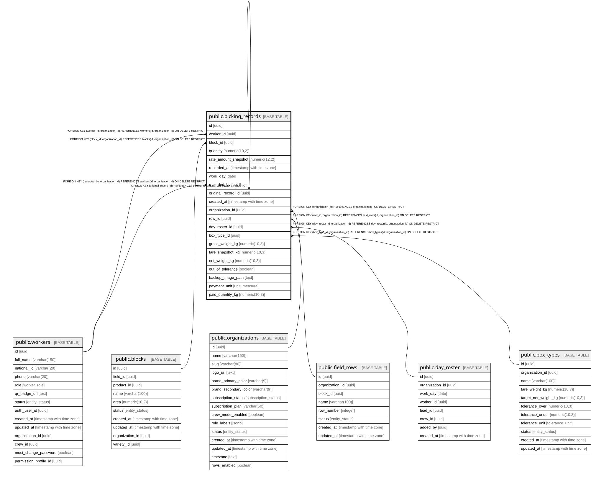

# public.picking_records

## Description

Individual harvest entries. Each record = one delivery of boxes/kg by a worker.

## Columns

| Name                 | Type                     | Default           | Nullable | Children                                            | Parents                                                                                                                                                                                                                                           | Comment                                                                                                                                                                                                |
| -------------------- | ------------------------ | ----------------- | -------- | --------------------------------------------------- | ------------------------------------------------------------------------------------------------------------------------------------------------------------------------------------------------------------------------------------------------- | ------------------------------------------------------------------------------------------------------------------------------------------------------------------------------------------------------ |
| id                   | uuid                     | gen_random_uuid() | false    | [public.picking_records](public.picking_records.md) |                                                                                                                                                                                                                                                   |                                                                                                                                                                                                        |
| worker_id            | uuid                     |                   | false    |                                                     | [public.workers](public.workers.md)                                                                                                                                                                                                               |                                                                                                                                                                                                        |
| block_id             | uuid                     |                   | false    |                                                     | [public.blocks](public.blocks.md)                                                                                                                                                                                                                 |                                                                                                                                                                                                        |
| quantity             | numeric(10,2)            |                   | false    |                                                     |                                                                                                                                                                                                                                                   | Units harvested (boxes or kg). Must be \> 0.                                                                                                                                                           |
| rate_amount_snapshot | numeric(12,2)            |                   | false    |                                                     |                                                                                                                                                                                                                                                   | Rate frozen at time of recording for traceability.                                                                                                                                                     |
| recorded_at          | timestamp with time zone | now()             | false    |                                                     |                                                                                                                                                                                                                                                   |                                                                                                                                                                                                        |
| work_day             | date                     |                   | false    |                                                     |                                                                                                                                                                                                                                                   |                                                                                                                                                                                                        |
| recorded_by          | uuid                     |                   | false    |                                                     | [public.workers](public.workers.md)                                                                                                                                                                                                               | Supervisor who registered this entry.                                                                                                                                                                  |
| original_record_id   | uuid                     |                   | true     |                                                     | [public.picking_records](public.picking_records.md)                                                                                                                                                                                               | If this is a correction, points to the original record.                                                                                                                                                |
| created_at           | timestamp with time zone | now()             | false    |                                                     |                                                                                                                                                                                                                                                   |                                                                                                                                                                                                        |
| organization_id      | uuid                     |                   | false    |                                                     | [public.organizations](public.organizations.md) [public.blocks](public.blocks.md) [public.workers](public.workers.md) [public.field_rows](public.field_rows.md) [public.day_roster](public.day_roster.md) [public.box_types](public.box_types.md) | Tenant propietario. Debe coincidir con el de worker y block (FK compuesta).                                                                                                                            |
| row_id               | uuid                     |                   | true     |                                                     | [public.field_rows](public.field_rows.md)                                                                                                                                                                                                         | Melga (field_rows) opcional de donde salió la cosecha. NULL si el tenant/campo no usa melgas. Debe pertenecer al mismo block_id del registro.                                                          |
| day_roster_id        | uuid                     |                   | true     |                                                     | [public.day_roster](public.day_roster.md)                                                                                                                                                                                                         | Roster del día (day_roster) bajo el cual se registró la producción. Congela la atribución trabajador-responsable de esa jornada. NULL para registros sin roster.                                       |
| box_type_id          | uuid                     |                   | true     |                                                     | [public.box_types](public.box_types.md)                                                                                                                                                                                                           | Tipo de caja usada (box_types). NULL si el tenant/producto no usa control de destare. Debe pertenecer al mismo tenant.                                                                                 |
| gross_weight_kg      | numeric(10,3)            |                   | true     |                                                     |                                                                                                                                                                                                                                                   | Peso bruto pesado en balanza (kg), incluye la tara. Snapshot inmutable de auditoría.                                                                                                                   |
| tare_snapshot_kg     | numeric(10,3)            |                   | true     |                                                     |                                                                                                                                                                                                                                                   | Tara aplicada al momento del registro (kg), congelada desde box_types.tare_weight_kg.                                                                                                                  |
| net_weight_kg        | numeric(10,3)            |                   | true     |                                                     |                                                                                                                                                                                                                                                   | Peso neto = bruto - tara (kg). Snapshot inmutable de auditoría. No altera el pago (que es por quantity).                                                                                               |
| out_of_tolerance     | boolean                  | false             | false    |                                                     |                                                                                                                                                                                                                                                   | true si el peso neto quedó fuera de la banda de tolerancia de la caja al registrar. Alerta de merma, no bloqueante.                                                                                    |
| backup_image_path    | text                     |                   | true     |                                                     |                                                                                                                                                                                                                                                   | Ruta (storage key) de la foto de respaldo en el bucket privado picking-evidence. NULL si no se adjuntó. Formato {org_id}/{record_id}/{uuid}.jpg. Se accede con URL firmada temporal; nunca es pública. |
| payment_unit         | unit_measure             |                   | false    |                                                     |                                                                                                                                                                                                                                                   | Unidad de pago congelada al registrar (box\|kg). box: pago por quantity; kg: pago por paid_quantity_kg.                                                                                                |
| paid_quantity_kg     | numeric(10,3)            |                   | true     |                                                     |                                                                                                                                                                                                                                                   | Kilos pagables (snapshot inmutable). Obligatorio y \> 0 cuando payment_unit=kg; NULL cuando payment_unit=box.                                                                                          |

## Constraints

| Name                                       | Type        | Definition                                                                                                                                                                                        | Comment                                                                                 |
| ------------------------------------------ | ----------- | ------------------------------------------------------------------------------------------------------------------------------------------------------------------------------------------------- | --------------------------------------------------------------------------------------- |
| chk_picking_paid_kg                        | CHECK       | CHECK ((((payment_unit = 'box'::unit_measure) AND (paid_quantity_kg IS NULL)) OR ((payment_unit = 'kg'::unit_measure) AND (paid_quantity_kg IS NOT NULL) AND (paid_quantity_kg > (0)::numeric)))) |                                                                                         |
| picking_records_backup_image_path_check    | CHECK       | CHECK (((backup_image_path IS NULL) OR (length(backup_image_path) > 0)))                                                                                                                          |                                                                                         |
| picking_records_gross_weight_kg_check      | CHECK       | CHECK (((gross_weight_kg IS NULL) OR (gross_weight_kg >= (0)::numeric)))                                                                                                                          |                                                                                         |
| picking_records_net_weight_kg_check        | CHECK       | CHECK (((net_weight_kg IS NULL) OR (net_weight_kg >= (0)::numeric)))                                                                                                                              |                                                                                         |
| picking_records_quantity_check             | CHECK       | CHECK ((quantity > (0)::numeric))                                                                                                                                                                 |                                                                                         |
| picking_records_rate_amount_snapshot_check | CHECK       | CHECK ((rate_amount_snapshot > (0)::numeric))                                                                                                                                                     |                                                                                         |
| picking_records_tare_snapshot_kg_check     | CHECK       | CHECK (((tare_snapshot_kg IS NULL) OR (tare_snapshot_kg >= (0)::numeric)))                                                                                                                        |                                                                                         |
| picking_records_original_record_id_fkey    | FOREIGN KEY | FOREIGN KEY (original_record_id) REFERENCES picking_records(id) ON DELETE RESTRICT                                                                                                                |                                                                                         |
| picking_records_pkey                       | PRIMARY KEY | PRIMARY KEY (id)                                                                                                                                                                                  |                                                                                         |
| picking_records_organization_id_fkey       | FOREIGN KEY | FOREIGN KEY (organization_id) REFERENCES organizations(id) ON DELETE RESTRICT                                                                                                                     |                                                                                         |
| fk_picking_block_org                       | FOREIGN KEY | FOREIGN KEY (block_id, organization_id) REFERENCES blocks(id, organization_id) ON DELETE RESTRICT                                                                                                 | Garantiza que el picking_record y su block pertenecen a la misma organización.          |
| fk_picking_recorded_by_org                 | FOREIGN KEY | FOREIGN KEY (recorded_by, organization_id) REFERENCES workers(id, organization_id) ON DELETE RESTRICT                                                                                             |                                                                                         |
| fk_picking_worker_org                      | FOREIGN KEY | FOREIGN KEY (worker_id, organization_id) REFERENCES workers(id, organization_id) ON DELETE RESTRICT                                                                                               |                                                                                         |
| fk_picking_row_org                         | FOREIGN KEY | FOREIGN KEY (row_id, organization_id) REFERENCES field_rows(id, organization_id) ON DELETE RESTRICT                                                                                               | Garantiza que el picking_record y su melga pertenecen a la misma organización.          |
| fk_picking_day_roster_org                  | FOREIGN KEY | FOREIGN KEY (day_roster_id, organization_id) REFERENCES day_roster(id, organization_id) ON DELETE RESTRICT                                                                                        | Garantiza que el picking_record y su roster del día pertenecen a la misma organización. |
| fk_picking_box_type_org                    | FOREIGN KEY | FOREIGN KEY (box_type_id, organization_id) REFERENCES box_types(id, organization_id) ON DELETE RESTRICT                                                                                           | Garantiza que el picking_record y su tipo de caja pertenecen a la misma organización.   |

## Indexes

| Name                                 | Definition                                                                                                                                 |
| ------------------------------------ | ------------------------------------------------------------------------------------------------------------------------------------------ |
| picking_records_pkey                 | CREATE UNIQUE INDEX picking_records_pkey ON public.picking_records USING btree (id)                                                        |
| idx_picking_records_worker_day       | CREATE INDEX idx_picking_records_worker_day ON public.picking_records USING btree (worker_id, work_day)                                    |
| idx_picking_records_block_day        | CREATE INDEX idx_picking_records_block_day ON public.picking_records USING btree (block_id, work_day)                                      |
| idx_picking_records_work_day         | CREATE INDEX idx_picking_records_work_day ON public.picking_records USING btree (work_day)                                                 |
| idx_picking_records_recorded_by      | CREATE INDEX idx_picking_records_recorded_by ON public.picking_records USING btree (recorded_by)                                           |
| idx_picking_records_organization     | CREATE INDEX idx_picking_records_organization ON public.picking_records USING btree (organization_id)                                      |
| idx_picking_records_row_id           | CREATE INDEX idx_picking_records_row_id ON public.picking_records USING btree (row_id) WHERE (row_id IS NOT NULL)                          |
| idx_picking_records_day_roster       | CREATE INDEX idx_picking_records_day_roster ON public.picking_records USING btree (day_roster_id) WHERE (day_roster_id IS NOT NULL)        |
| idx_picking_records_box_type_id      | CREATE INDEX idx_picking_records_box_type_id ON public.picking_records USING btree (box_type_id) WHERE (box_type_id IS NOT NULL)           |
| idx_picking_records_out_of_tolerance | CREATE INDEX idx_picking_records_out_of_tolerance ON public.picking_records USING btree (organization_id, work_day) WHERE out_of_tolerance |
| idx_picking_payment_unit             | CREATE INDEX idx_picking_payment_unit ON public.picking_records USING btree (payment_unit)                                                 |

## Triggers

| Name                           | Definition                                                                                                                                |
| ------------------------------ | ----------------------------------------------------------------------------------------------------------------------------------------- |
| trg_set_org_id_picking_records | CREATE TRIGGER trg_set_org_id_picking_records BEFORE INSERT ON public.picking_records FOR EACH ROW EXECUTE FUNCTION set_organization_id() |
| trg_picking_set_work_day       | CREATE TRIGGER trg_picking_set_work_day BEFORE INSERT ON public.picking_records FOR EACH ROW EXECUTE FUNCTION set_picking_work_day()      |

## Relations

---

> Generated by [tbls](https://github.com/k1LoW/tbls)
