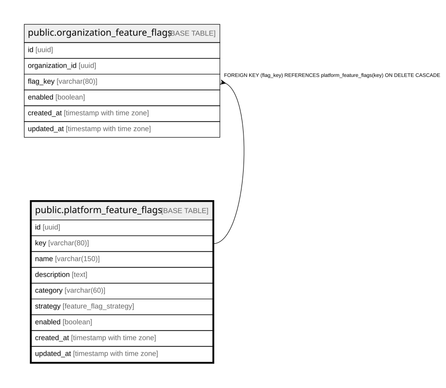

# public.platform_feature_flags

## Description

Catálogo global de feature flags de la plataforma (super-admin). Default global en enabled; override por tenant en organization_feature_flags.

## Columns

| Name        | Type                     | Default                               | Nullable | Children                                                                  | Parents | Comment                                                                                                                                  |
| ----------- | ------------------------ | ------------------------------------- | -------- | ------------------------------------------------------------------------- | ------- | ---------------------------------------------------------------------------------------------------------------------------------------- |
| id          | uuid                     | gen_random_uuid()                     | false    |                                                                           |         |                                                                                                                                          |
| key         | varchar(80)              |                                       | false    | [public.organization_feature_flags](public.organization_feature_flags.md) |         | Identificador estable del flag, usado por las apps para consultar su estado.                                                             |
| name        | varchar(150)             |                                       | false    |                                                                           |         |                                                                                                                                          |
| description | text                     |                                       | true     |                                                                           |         |                                                                                                                                          |
| category    | varchar(60)              | 'general'::character varying          | false    |                                                                           |         |                                                                                                                                          |
| strategy    | feature_flag_strategy    | 'org_override'::feature_flag_strategy | false    |                                                                           |         | Informativa: global (mismo valor para todos), org_override (se puede sobreescribir por tenant), kill_switch (interruptor de emergencia). |
| enabled     | boolean                  | false                                 | false    |                                                                           |         | Valor por defecto global del flag cuando no hay override para la organización.                                                           |
| created_at  | timestamp with time zone | now()                                 | false    |                                                                           |         |                                                                                                                                          |
| updated_at  | timestamp with time zone | now()                                 | false    |                                                                           |         |                                                                                                                                          |

## Constraints

| Name                           | Type        | Definition                                               |
| ------------------------------ | ----------- | -------------------------------------------------------- |
| chk_platform_feature_flags_key | CHECK       | CHECK (((key)::text ~ '^[a-z0-9]+(_[a-z0-9]+)*$'::text)) |
| platform_feature_flags_pkey    | PRIMARY KEY | PRIMARY KEY (id)                                         |
| uq_platform_feature_flags_key  | UNIQUE      | UNIQUE (key)                                             |

## Indexes

| Name                                | Definition                                                                                               |
| ----------------------------------- | -------------------------------------------------------------------------------------------------------- |
| platform_feature_flags_pkey         | CREATE UNIQUE INDEX platform_feature_flags_pkey ON public.platform_feature_flags USING btree (id)        |
| uq_platform_feature_flags_key       | CREATE UNIQUE INDEX uq_platform_feature_flags_key ON public.platform_feature_flags USING btree (key)     |
| idx_platform_feature_flags_category | CREATE INDEX idx_platform_feature_flags_category ON public.platform_feature_flags USING btree (category) |

## Triggers

| Name                                  | Definition                                                                                                                                                   |
| ------------------------------------- | ------------------------------------------------------------------------------------------------------------------------------------------------------------ |
| trg_platform_feature_flags_updated_at | CREATE TRIGGER trg_platform_feature_flags_updated_at BEFORE UPDATE ON public.platform_feature_flags FOR EACH ROW EXECUTE FUNCTION update_updated_at_column() |

## Relations

---

> Generated by [tbls](https://github.com/k1LoW/tbls)
