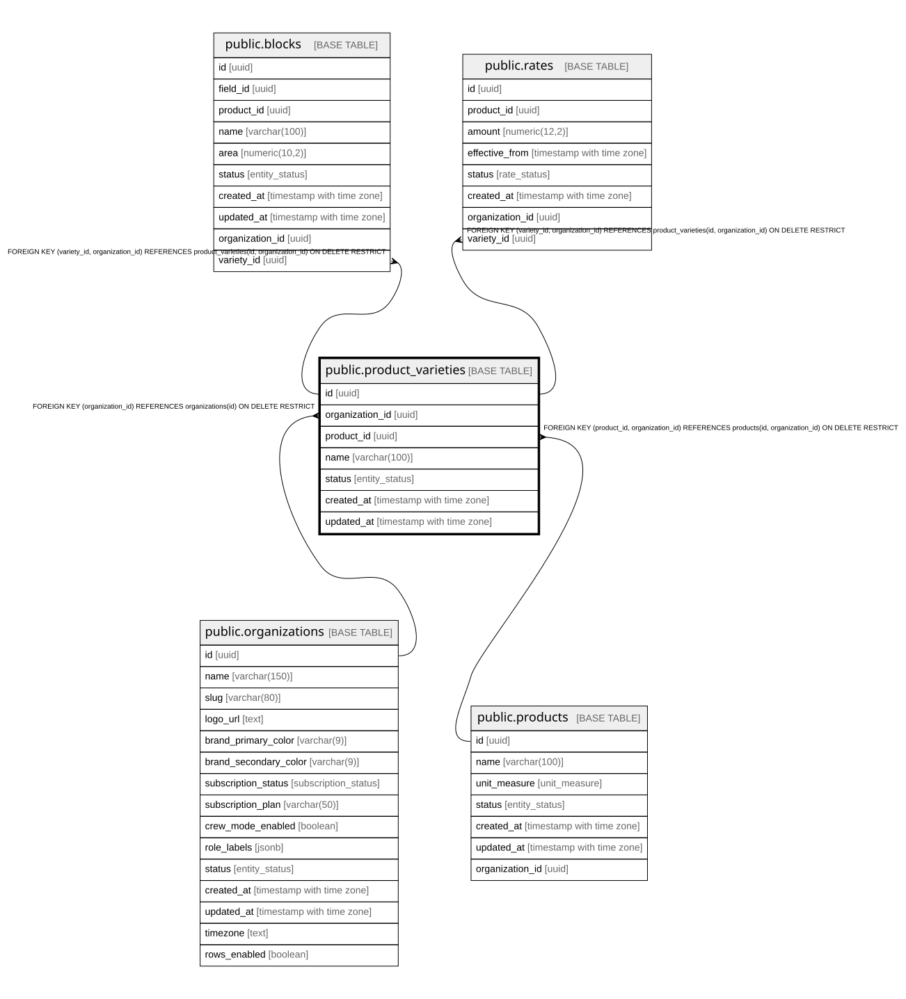

# public.product_varieties

## Description

Variedades de producto por organización (nivel jerárquico bajo el producto). Un producto puede tener 0..N variedades; cada variedad puede asignarse a paños y tener tarifa propia.

## Columns

| Name            | Type                     | Default                 | Nullable | Children                                                          | Parents                                                                               | Comment                                                                                      |
| --------------- | ------------------------ | ----------------------- | -------- | ----------------------------------------------------------------- | ------------------------------------------------------------------------------------- | -------------------------------------------------------------------------------------------- |
| id              | uuid                     | gen_random_uuid()       | false    | [public.blocks](public.blocks.md) [public.rates](public.rates.md) |                                                                                       |                                                                                              |
| organization_id | uuid                     |                         | false    | [public.blocks](public.blocks.md) [public.rates](public.rates.md) | [public.organizations](public.organizations.md) [public.products](public.products.md) |                                                                                              |
| product_id      | uuid                     |                         | false    |                                                                   | [public.products](public.products.md)                                                 | Producto al que pertenece la variedad (FK compuesta de tenant a products).                   |
| name            | varchar(100)             |                         | false    |                                                                   |                                                                                       | Nombre de la variedad, único (case-insensitive) entre variedades activas del mismo producto. |
| status          | entity_status            | 'active'::entity_status | false    |                                                                   |                                                                                       |                                                                                              |
| created_at      | timestamp with time zone | now()                   | false    |                                                                   |                                                                                       |                                                                                              |
| updated_at      | timestamp with time zone | now()                   | false    |                                                                   |                                                                                       |                                                                                              |

## Constraints

| Name                                   | Type        | Definition                                                                                            |
| -------------------------------------- | ----------- | ----------------------------------------------------------------------------------------------------- |
| product_varieties_organization_id_fkey | FOREIGN KEY | FOREIGN KEY (organization_id) REFERENCES organizations(id) ON DELETE RESTRICT                         |
| fk_variety_product_org                 | FOREIGN KEY | FOREIGN KEY (product_id, organization_id) REFERENCES products(id, organization_id) ON DELETE RESTRICT |
| product_varieties_pkey                 | PRIMARY KEY | PRIMARY KEY (id)                                                                                      |
| uq_product_varieties_id_org            | UNIQUE      | UNIQUE (id, organization_id)                                                                          |

## Indexes

| Name                                  | Definition                                                                                                                                                                   |
| ------------------------------------- | ---------------------------------------------------------------------------------------------------------------------------------------------------------------------------- |
| product_varieties_pkey                | CREATE UNIQUE INDEX product_varieties_pkey ON public.product_varieties USING btree (id)                                                                                      |
| uq_product_varieties_id_org           | CREATE UNIQUE INDEX uq_product_varieties_id_org ON public.product_varieties USING btree (id, organization_id)                                                                |
| idx_product_varieties_organization    | CREATE INDEX idx_product_varieties_organization ON public.product_varieties USING btree (organization_id)                                                                    |
| idx_product_varieties_product         | CREATE INDEX idx_product_varieties_product ON public.product_varieties USING btree (product_id)                                                                              |
| idx_product_varieties_status          | CREATE INDEX idx_product_varieties_status ON public.product_varieties USING btree (status)                                                                                   |
| uq_product_varieties_name_per_product | CREATE UNIQUE INDEX uq_product_varieties_name_per_product ON public.product_varieties USING btree (product_id, lower((name)::text)) WHERE (status = 'active'::entity_status) |

## Triggers

| Name                             | Definition                                                                                                                                         |
| -------------------------------- | -------------------------------------------------------------------------------------------------------------------------------------------------- |
| trg_product_varieties_updated_at | CREATE TRIGGER trg_product_varieties_updated_at BEFORE UPDATE ON public.product_varieties FOR EACH ROW EXECUTE FUNCTION update_updated_at_column() |
| trg_set_org_id_product_varieties | CREATE TRIGGER trg_set_org_id_product_varieties BEFORE INSERT ON public.product_varieties FOR EACH ROW EXECUTE FUNCTION set_organization_id()      |

## Relations

---

> Generated by [tbls](https://github.com/k1LoW/tbls)
